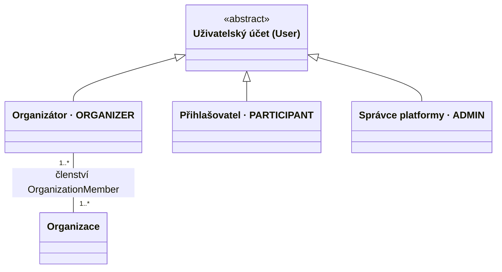
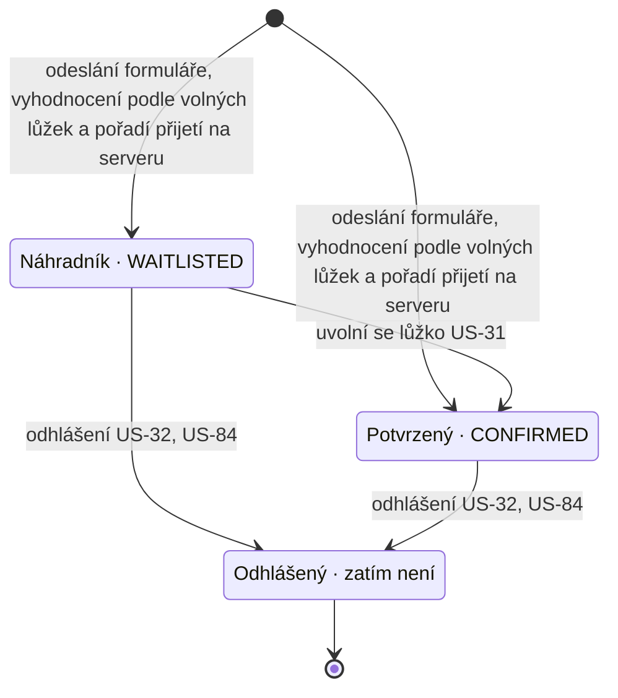
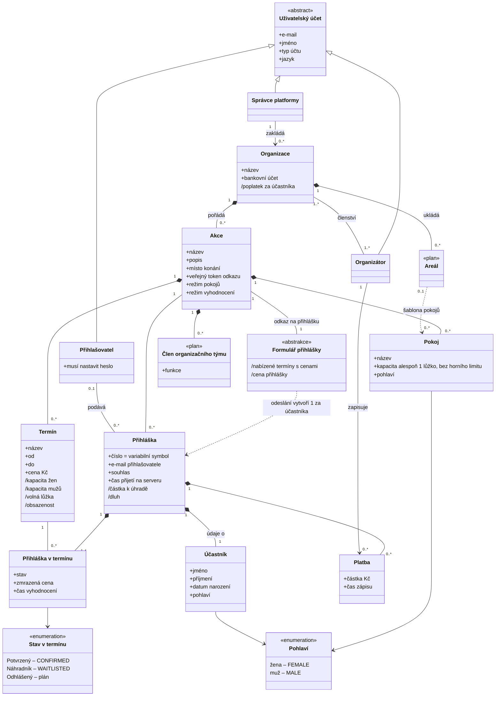
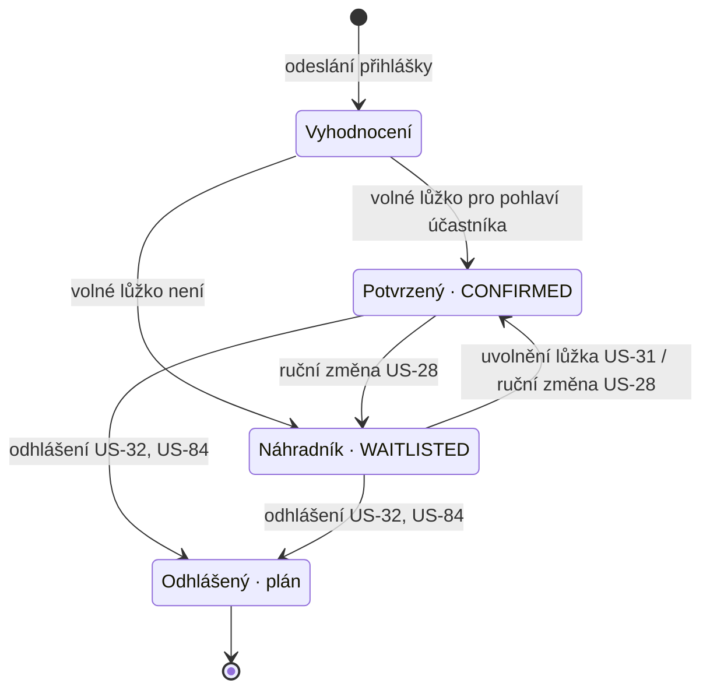
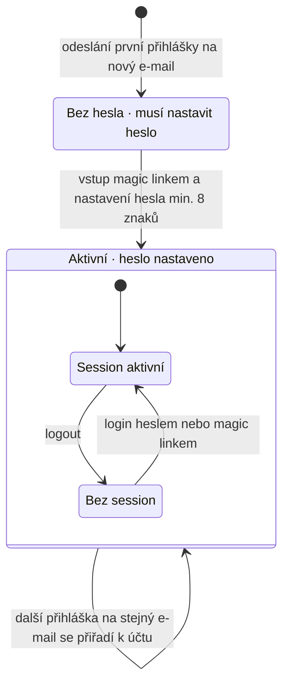
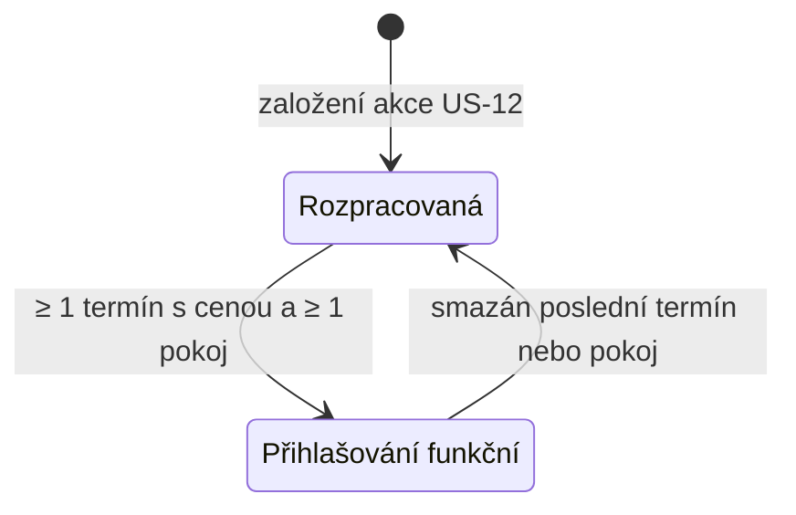
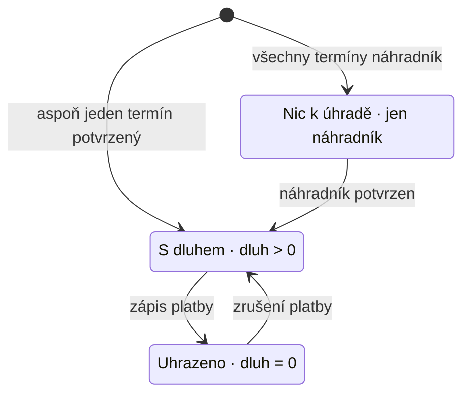

# Togena – slovník pojmů business domény

Oct 20, 2026 · @Adam Hanuš

Jen pojmy, které se v projektu pletou nebo mají víc významů. Zdroje: [docs/PROJEKT.md](https://github.com/applifting-vsecourse/team-1/blob/main/docs/PROJEKT.md) (§7 Slovník, §8 Datový model, §10 Rozhodnutí), [schema.prisma](https://github.com/applifting-vsecourse/team-1/blob/main/apps/backend/prisma/schema.prisma) a 97 issues na [boardu](https://github.com/orgs/applifting-vsecourse/projects/12). Pořadí platnosti: rozhodnutí v PROJEKT.md > schéma > text issue.

## Jak číst

Každý pojem patří právě do jedné kategorie:

| Kategorie         | Co to je                                     | Test                                | Do class diagramu jako        |
| ----------------- | -------------------------------------------- | ----------------------------------- | ----------------------------- |
| Entita            | Věc s vlastní identitou a životním cyklem    | Má vlastní tabulku nebo ji mít bude | třída                         |
| Specializace      | Podtyp entity                                | „X je druh Y“                       | podtřída, generalizace        |
| Stav              | Hodnota stavového atributu entity            | „X je ve stavu S“                   | enum, stavový diagram         |
| Atribut / výpočet | Vlastnost entity nebo hodnota počítaná z dat | Neexistuje samostatně               | atribut, odvozený atribut `/` |

## Entity

| Entita                  | Význam                                                                                                                                                                                | V kódu                                               | Pozor                                                                                                                      |
| ----------------------- | ------------------------------------------------------------------------------------------------------------------------------------------------------------------------------------- | ---------------------------------------------------- | -------------------------------------------------------------------------------------------------------------------------- |
| Organizace              | Subjekt, který akce pořádá (spolek, firma, oddíl); data izolovaná od ostatních organizací ([US-10](https://github.com/applifting-vsecourse/team-1/issues/10)).                        | `Organization`                                       | Jediný pojem v textu i kódu. „Pořadatel“ nepoužívat.                                                                       |
| Uživatelský účet        | Účet s přihlašovacími údaji; generalizace pro organizátora, přihlašovatele a správce.                                                                                                 | `User`                                               | Holé „účet“ nepoužívat; nezaměňovat s bankovním účtem.                                                                     |
| Akce                    | Celek s jedním odkazem na přihlášku a více termíny.                                                                                                                                   | `Event`                                              | Ročník = další instance akce vzniklá kopií ([US-21](https://github.com/applifting-vsecourse/team-1/issues/21)), ne termín. |
| Termín                  | Konkrétní běh akce s datem od–do a cenou; vyhodnocuje se samostatně.                                                                                                                  | `Term`                                               | Nepoužívat „turnus“, „běh“.                                                                                                |
| Pokoj                   | Ubytovací jednotka akce, platí pro všechny termíny.                                                                                                                                   | `Room`                                               | Dámský / pánský je atribut `gender`, ne podtyp.                                                                            |
| Formulář přihlášky      | Veřejná stránka, kterou přihlašovatel vyplní za sebe nebo za více účastníků; digitální obdoba papírové přihlášky ([US-23](https://github.com/applifting-vsecourse/team-1/issues/23)). | `features/application-form`, data z `Event` + `Term` | Šablona, ne záznam. Jedno odeslání = přihláška za každého účastníka.                                                       |
| Přihláška               | Vyplněný záznam jednoho účastníka na akci.                                                                                                                                            | `Application`                                        | Sama stav nemá, stav mají její termíny.                                                                                    |
| Přihláška v termínu     | Vazba přihlášky na jeden vybraný termín, nese stav a zmrazenou cenu.                                                                                                                  | `ApplicationTerm`                                    | Asociační třída mezi Přihláškou a Termínem.                                                                                |
| Účastník                | Osoba, která fyzicky jede na akci; údaje v přihlášce (jméno, datum narození, pohlaví).                                                                                                | údaje v `Application`                                | Nemusí mít uživatelský účet. Nezaměňovat s přihlašovatelem.                                                                |
| Platba                  | Jeden ručně zapsaný příjem k přihlášce.                                                                                                                                               | `Payment`                                            | Řádek, ne příznak „zaplaceno“.                                                                                             |
| Areál                   | Uložená sada pokojů k opakovanému použití ([US-81](https://github.com/applifting-vsecourse/team-1/issues/81)).                                                                        | zatím není                                           | V [US-59](https://github.com/applifting-vsecourse/team-1/issues/59) jde o výdajovou položku.                               |
| Člen organizačního týmu | Personál akce: vedoucí, kuchař, zdravotník ([US-93](https://github.com/applifting-vsecourse/team-1/issues/93)).                                                                       | zatím není                                           | Nemá účet; nezaměňovat s dalším organizátorem ([US-11](https://github.com/applifting-vsecourse/team-1/issues/11)).         |

## Specializace

Uživatelský účet se dělí podle `AccountType`. Specializace je disjunktní a úplná: jeden e-mail má právě jeden typ.

| Specializace      | Význam                                                                                                                                                                                                                        | Pozor                                                                                                        |
| ----------------- | ----------------------------------------------------------------------------------------------------------------------------------------------------------------------------------------------------------------------------- | ------------------------------------------------------------------------------------------------------------ |
| Organizátor       | Spravuje akce za jednu nebo více organizací.                                                                                                                                                                                  | Není to organizace.                                                                                          |
| Přihlašovatel     | Podává přihlášky za sebe nebo za jiné ([US-05](https://github.com/applifting-vsecourse/team-1/issues/05), [US-06](https://github.com/applifting-vsecourse/team-1/issues/06)); účet vzniká odesláním přihlášky na jeho e-mail. | Nemusí na akci jet (rodič za dítě). V kódu se typ jmenuje `PARTICIPANT`, viz rozpory.                        |
| Správce platformy | Provozovatel Togeny; zakládá organizace ([US-08](https://github.com/applifting-vsecourse/team-1/issues/08)).                                                                                                                  | Není to správce osobních údajů dle GDPR ([US-77](https://github.com/applifting-vsecourse/team-1/issues/77)). |

Co specializací není:

- Kemp, soustředění, LARP – příklady akcí; typ akce zatím jen jako nastavení ([US-20](https://github.com/applifting-vsecourse/team-1/issues/20)).
- Dámský / pánský pokoj – hodnota atributu `Room.gender`.
- Náhradník – stav, viz níže.
- Účastník – samostatná entita, ne typ účtu.

Přihlašovatel a účastník můžou být jedna osoba (přihlašuje sám sebe), nebo dvě (rodič a dítě).

## Stavy

Stav nese Přihláška v termínu (`ApplicationTerm.status`), ne Přihláška.

| Stav      | Význam                                                 | V kódu       | Pozor                                                                                                  |
| --------- | ------------------------------------------------------ | ------------ | ------------------------------------------------------------------------------------------------------ |
| Potvrzený | V termínu se účastník vešel do kapacity svého pohlaví. | `CONFIRMED`  | Nezaměňovat s potvrzovacím e-mailem.                                                                   |
| Náhradník | V termínu nedostal lůžko.                              | `WAITLISTED` | Stav v termínu, ne typ osoby. Jedna přihláška může být v jednom termínu potvrzená a v jiném náhradník. |
| Odhlášený | Zrušená účast v termínu nebo celé přihlášce.           | zatím není   | Není to logout.                                                                                        |

## Atributy a výpočty

| Pojem                 | Patří k             | Vzorec / význam                                                                                                                                                                    | V kódu                                   | Pozor                                                                                                 |
| --------------------- | ------------------- | ---------------------------------------------------------------------------------------------------------------------------------------------------------------------------------- | ---------------------------------------- | ----------------------------------------------------------------------------------------------------- |
| Lůžko                 | Pokoj               | jednotka kapacity pokoje                                                                                                                                                           | `Room.capacity`                          | Jako entita zatím neexistuje.                                                                         |
| Volná lůžka           | Termín              | kapacita pohlaví − potvrzení daného pohlaví                                                                                                                                        | doménová funkce                          | Nepoužívat „volná místa“ – plete se s místem konání.                                                  |
| Obsazenost            | Termín              | kapacita, potvrzení, volná lůžka, náhradníci ([US-29](https://github.com/applifting-vsecourse/team-1/issues/29))                                                                   | `/occupancy`                             | Obsazenost pokojů ([US-36](https://github.com/applifting-vsecourse/team-1/issues/36)) = kdo leží kde. |
| Režim pokojů          | Akce                | pokoje podle pohlaví, nebo společné pokoje ([US-14](https://github.com/applifting-vsecourse/team-1/issues/14))                                                                     | `Event.roomMode` (`GENDERED` / `SHARED`) | Vždy psát celý název, ne holé „režim“.                                                                |
| Režim vyhodnocení     | Akce                | automatické potvrzení, nebo s organizátorem ([US-27](https://github.com/applifting-vsecourse/team-1/issues/27), [US-82](https://github.com/applifting-vsecourse/team-1/issues/82)) | zatím není, ve sprintu 1 jen automatický | Vždy psát celý název, ne holé „režim“.                                                                |
| Zmrazená cena         | Přihláška v termínu | cena termínu v okamžiku vyhodnocení                                                                                                                                                | `ApplicationTerm.priceCzk`               | Pozdější změna ceny se týká jen nových přihlášek.                                                     |
| Cena přihlášky        | Formulář            | Σ cen vybraných termínů ([US-40](https://github.com/applifting-vsecourse/team-1/issues/40))                                                                                        | FE výpočet                               | Orientační; nerovná se částce k úhradě.                                                               |
| Částka k úhradě       | Přihláška           | Σ zmrazených cen potvrzených termínů                                                                                                                                               | `amountDue`                              | Náhradní termíny se nepočítají.                                                                       |
| Dluh                  | Přihláška           | částka k úhradě − Σ plateb                                                                                                                                                         | `amountOwed`                             | –                                                                                                     |
| Variabilní symbol     | Přihláška           | = číslo přihlášky, globální sekvence                                                                                                                                               | `Application.number`                     | Viz rozpory níže.                                                                                     |
| Bankovní účet         | Organizace          | číslo účtu pro převody                                                                                                                                                             | `Organization.bankAccount`               | Nezaměňovat s uživatelským účtem.                                                                     |
| Poplatek za účastníka | Organizace          | počet potvrzených × sazba platformy ([US-70](https://github.com/applifting-vsecourse/team-1/issues/70))                                                                            | zatím není                               | Ne poplatek platební brány ([US-50](https://github.com/applifting-vsecourse/team-1/issues/50)).       |

## Class diagram

Celá business doména. Atributy s `/` jsou odvozené, třídy `<<plan>>` zatím nejsou v kódu, `<<abstrakce>>` nemá vlastní tabulku.

Přihláška v termínu je asociační třída mezi Přihláškou a Termínem: jedna instance na každý vybraný termín, vazba `Přihláška` × `Termín` je unikátní.

## Stavové diagramy

### Přihláška v termínu

Jediný skutečný stav v doméně. Ve sprintu 1 existuje jen vyhodnocení; ostatní přechody přidají [US-28](https://github.com/applifting-vsecourse/team-1/issues/28), [US-31](https://github.com/applifting-vsecourse/team-1/issues/31), [US-32](https://github.com/applifting-vsecourse/team-1/issues/32) a [US-84](https://github.com/applifting-vsecourse/team-1/issues/84).

### Uživatelský účet přihlašovatele

Účet vzniká odesláním první přihlášky na nový e-mail. Session je stav přístupu, ne stav osoby na akci, proto se jmenuje jinak než Odhlášený.

### Akce

Odkaz na přihlášku funguje, až má akce aspoň jeden termín s cenou a aspoň jeden pokoj. Naplánované otevření a uzavření přihlášek ([US-18](https://github.com/applifting-vsecourse/team-1/issues/18)) sem později přidá další stavy.

### Úhrada přihlášky

Odvozený stav – neukládá se, počítá se z částky k úhradě a plateb. Slouží filtrům „zaplaceno“ a přehledu dlužníků.

## Kolize pojmů

Všechny kolize ve slovníku jsou rozhodnuté. Vědomě ponecháno:

- „Organiz…“ – Organizace × Organizátor × Člen organizačního týmu sdílejí kořen; rozlišují se celým názvem.
- „Cena přihlášky“ – počítá se na formuláři; od Částky k úhradě ji odlišuje sloupec Pozor.

## Rozpory mezi zdroji

Tyto body nejsou jen jazykové – zdroje si odporují věcně:

- Pokoj bez pohlaví: pro US-14 potvrzeny oba režimy pokojů. `Event.roomMode` je `GENDERED` nebo `SHARED`; společné pokoje mají `Room.gender = null` a jednu společnou kapacitu. Před návratem ze společného na dělený režim je nutné společné pokoje odstranit.
- Název: Figma soubory a některé texty ještě nesou „kemp.io“, produkt je od 16. 10. Togena.
- URL: komentáře ve schématu uvádějí `/prihlaska/<publicToken>` a `/prihlaska/potvrzeni/<accessToken>`, routy jsou `/apply/$token` a `/apply/confirmation/$accessToken`.
- Přihlašovatel × `PARTICIPANT`: typ účtu se v byznysu i v PROJEKT.md jmenuje Přihlašovatel, v kódu `PARTICIPANT` (mapování v sekci Specializace). Rozhodnout s tech leadem, zda přejmenovat na `APPLICANT`.

## Pravidla psaní

- Issues a dokumentace česky podle sloupce Pojem, kód podle sloupce V kódu – nic třetího.
- Nové pojmy se přidávají sem; PROJEKT.md §7 na slovník jen odkazuje.
- Story, která zavádí nový pojem, ho definuje v sekci Kontext jednou větou.
