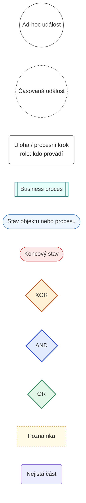
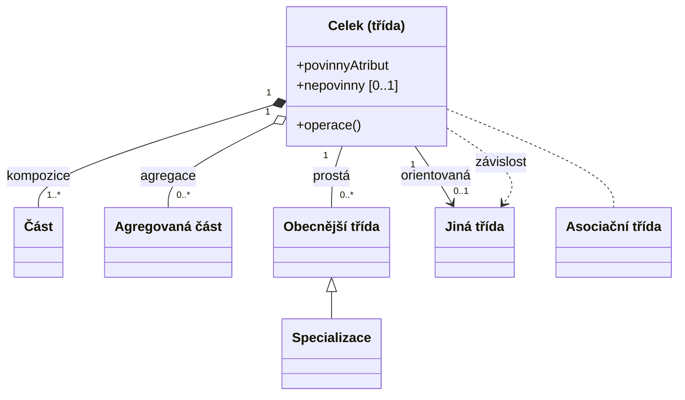
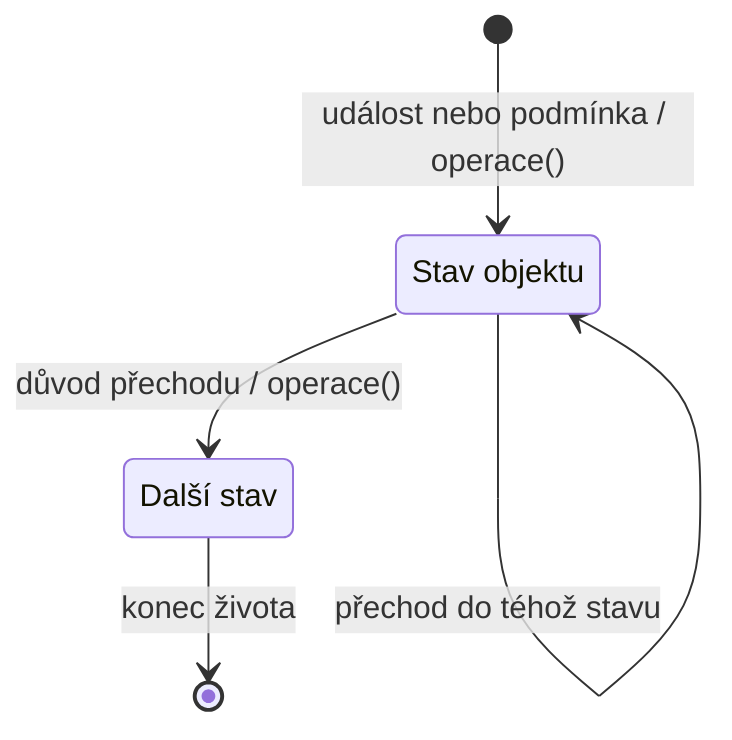

# Legenda diagramů

Co znamenají tvary a čáry v Mermaid diagramech generovaných z YAML (`generate.py`). Tři druhy diagramů: procesní, tříd, životní cyklus. Metodika je v [`MMABP_LITE.md`](MMABP_LITE.md).

## 1. Procesní diagram (`diagram: process`)

Procesní mapa (globální) i detailní proces. Čte se po šipkách od události ke stavům.

| Tvar a barva                      | Typ v YAML           | Význam                                                                                                                                                                                                                             |
| --------------------------------- | -------------------- | ---------------------------------------------------------------------------------------------------------------------------------------------------------------------------------------------------------------------------------- |
| kruh                              | `event`              | ad-hoc událost: příchozí informace, která spouští proces (např. „Customer Order placed“)                                                                                                                                           |
| kruh, tečkovaný okraj             | `timed`              | časovaná událost: časový okamžik nebo uplynutí lhůty                                                                                                                                                                               |
| zaoblený obdélník                 | `task`, `step`       | úloha (mění stav jednoho objektu) nebo procesní krok; pod názvem `role:` kdo ji provádí                                                                                                                                            |
| obdélník s dvojitými boky, zelený | `process`            | business proces v procesní mapě                                                                                                                                                                                                    |
| stadion, modrý                    | `state`              | stav objektu nebo procesu, kde se čeká na událost; název „Třída: stav“                                                                                                                                                             |
| stadion, červený                  | `end`                | koncový, cílový stav                                                                                                                                                                                                               |
| kosočtverec **XOR**, oranžový     | `gateway`, `kind: x` | exkluzivní brána: právě jedna větev (rozhodnutí)                                                                                                                                                                                   |
| kosočtverec **AND**, modrý        | `gateway`, `kind: +` | paralelní brána: všechny větve naráz (rozdělení nebo synchronizace); sama není stav procesu. Před událostí, na kterou proces čeká, ji generátor doplní sám: úloha → AND ← událost, proces dál nepokračuje, dokud nedorazí oba toky |
| kosočtverec **OR**, zelený        | `gateway`, `kind: o` | inkluzivní brána: aspoň jedna větev; používej výjimečně                                                                                                                                                                            |
| obdélník, žlutý, čárkovaný        | `note`               | poznámka                                                                                                                                                                                                                           |
| silný žlutý čárkovaný okraj       | `unsure: true`       | nejistá část náčrtku, k ověření                                                                                                                                                                                                    |

| Čára               | Význam                                                                        |
| ------------------ | ----------------------------------------------------------------------------- |
| plná šipka         | tok; `label` je popisek (např. podmínka větve nebo předávaná informace)       |
| čárkovaná šipka    | `dashed: true`: synchronizace nebo vazba mezi procesy a poznámkou, ne tok dat |
| rámeček s nadpisem | `groups`: seskupení, typicky jedna business funkce                            |

## 2. Diagram tříd (`diagram: class`)

Statická struktura: jaké objekty business zná a jak spolu souvisí.

| Prvek                                       | Typ v YAML                      | Význam                                                                           |
| ------------------------------------------- | ------------------------------- | -------------------------------------------------------------------------------- |
| obdélník se 3 oddíly                        | `classes`                       | třída: název, atributy, operace                                                  |
| atribut bez mohutnosti                      | `attrs`                         | povinný atribut                                                                  |
| `[0..1]` u atributu                         | `attrs`                         | nepovinný atribut                                                                |
| `+operace()`                                | `ops`                           | operace třídy (strukturální: New, add, set, remove)                              |
| `--`                                        | `assoc`                         | prostá asociace                                                                  |
| `-->`                                       | `directed`                      | jednostranná asociace (druhá strana se řeší životním cyklem)                     |
| plný kosočtverec `*--`                      | `composition`                   | kompozice: část existuje jen v jednom celku a bez něj ne; kosočtverec je u celku |
| prázdný kosočtverec `o--`                   | `aggregation`                   | agregace: část může existovat samostatně a být ve více celcích                   |
| prázdná trojúhelníková šipka `<\|--`        | `generalization`                | specializace míří na obecnější třídu                                             |
| `..>`                                       | `dependency`                    | závislost                                                                        |
| čárkovaná čára ke třídě                     | `assoc_class`                   | asociační třída: asociace s vlastními atributy                                   |
| čísla u konců (`1`, `0..1`, `1..*`, `0..*`) | `from_card`, `to_card`          | mohutnost; `1` povinná, `0..` nepovinná, `*` mnoho                               |
| text na čáře                                | `label`, `from_role`, `to_role` | název vazby nebo role                                                            |

## 3. Životní cyklus objektu (`diagram: lifecycle`)

Obecná pravidla jedné třídy: v jakých stavech může být a co ho přepíná. Jeden diagram = jedna třída, žádné brány.

| Prvek                                | Klíč v YAML   | Význam                                                                                                 |
| ------------------------------------ | ------------- | ------------------------------------------------------------------------------------------------------ |
| černá tečka `[*]` na začátku         | `from: start` | zrození objektu; nemá název, přechod nese důvod vzniku                                                 |
| zaoblený obdélník                    | `states`      | významný stav objektu (dokonaný i průběhový, např. „vyřizovaná“)                                       |
| černá tečka v kruhu `[*]` na konci   | `to: end`     | konec života objektu (koncový stav)                                                                    |
| šipka s popiskem `důvod / operace()` | `transitions` | přechod: `reason` je událost nebo podmínka (povinné), `op` operace existující ve třídě v diagramu tříd |

Z každého nekoncového stavu vedou aspoň dva přechody a aspoň jeden určitě nastane (např. časově), jinak hrozí deadlock. Generátor na to upozorní varováním.
