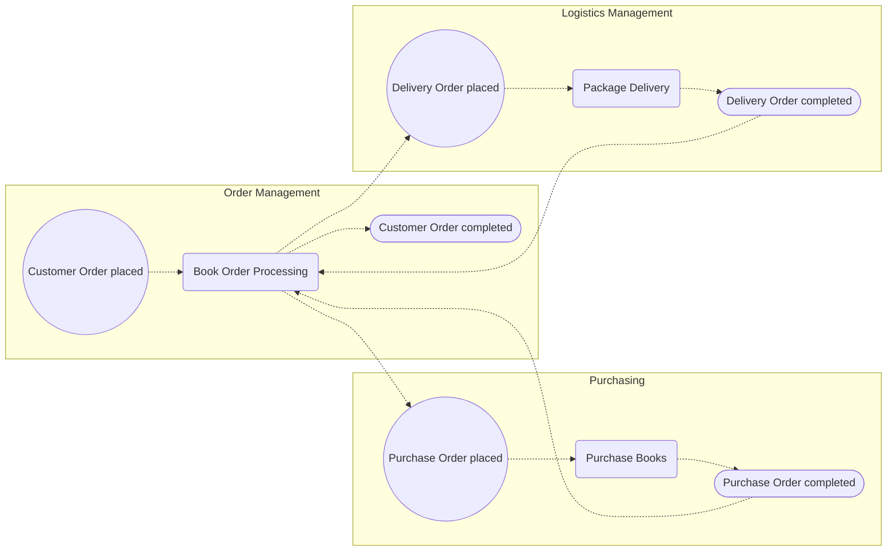

# MMABP lite

## 1. Účel a použití

- Kontext metodiky MMABP (A4 metoda) pro asistenty, kteří s uživatelem refinují procesní modely.
- Metodika je inspirace, ne validátor: ptej se, nabízej varianty.
- Model se píše v YAML (sekce 7), Mermaid se z něj generuje (`generate.py`): procesní diagramy, diagram tříd i životní cykly.
- Zdroje: A4 cheatsheet a slidy přednášek (procesní mapa, 3 – diagram tříd, 4 – životní cykly).

## 2. Čtyři pohledy

| Diagram                                      | Zachycuje                                 | Úroveň                   | Na co se dívat                                                                     |
| -------------------------------------------- | ----------------------------------------- | ------------------------ | ---------------------------------------------------------------------------------- |
| Globální procesní mapa (TOGAF Event diagram) | funkce, procesy, události, cílové stavy   | globální                 | Co a kdo proces spouští, jaká zpětná vazba se čeká; synchronizace, ne sdílená data |
| Diagram tříd (UML)                           | třídy, atributy, vazby, operace           | globální                 | Srozumitelnost bez hodnot atributů, bez implementace                               |
| Detailní procesní diagram (BPMN)             | kroky, úlohy, stavy procesu, brány        | detailní                 | Kde proces čeká na okolí a co když odpověď nepřijde                                |
| Životní cyklus objektu (UML state machine)   | stavy významné třídy, důvody přechodů     | detailní                 | Obecná pravidla objektu, ne chování k cíli                                         |
| Diagram toků a funkcí IS (DFD)               | funkce IS, hraniční prvky, toky, uložiště | navazující, mimo procesy | Co funkci spouští, její vstupy a výstupy                                           |

## 3. Slovník pojmů

- Business funkce: seskupení procesů tvořící jednu ze schopností podniku.
- Business proces: série činností vedoucí k cílovému výstupu pro potřebu zákazníka procesu, od jejího vyjádření po uspokojení.
- Klíčový proces: svázaný přímo se zákazníkem businessu; podpůrný proces: podporuje jiný proces svým cílovým výstupem, může být outsourcovaný.
- Orchestrační proces: má podpůrné procesy a jeho cílem je jejich orchestrace; prostý proces: žádné nemá, jen úlohy.
- Ad-hoc událost: příchozí informace (explicitní či implicitní vyjádření potřeby) spouštějící proces.
- Časovaná událost: časový okamžik nebo uplynutí lhůty; A4 u spouštění přidává splnění business rule.
- Cílový stav: stav business objektu značící uspokojení potřeby zákazníka procesu.
- Milník: zásadní moment na cestě k uspokojení potřeby, stav business objektu; hledej tam, kde se mění jednotka zpracování.
- Procesní krok: řetězec úloh proveditelný celý bez čekání na externí vstup.
- Úloha: činnost měnící stav jednoho významného objektu na jiný podle jeho životního cyklu.
- Stav procesu: místo, kde proces (mimo koncový) čeká na událost určující další směr; většinou stav významného objektu.
- Významný objekt: instance třídy se smysluplným životním cyklem, minimálně když její stav je výsledkem úloh nebo řídí větvení.
- Jednotka zpracování: objekt svázaný s ad-hoc spouštěcí událostí.
- Role: u úlohy atribut, kdo ji provádí.
- Zdroj: materiální, nemateriální nebo lidský prostředek, který procesy využívají nebo spotřebovávají.
- Objekt: entita s hranicemi a identitou, nese stav (atributy a vazby) a potenciální dynamiku (operace, životní cyklus); instance třídy. Třída: koncept množiny objektů se stejným významem, atributy a operacemi.
- Operace: vlastnost třídy popisující potenciální dynamiku; metoda je její implementace (v analýze se neřeší).
- Asociace: vazba mezi třídami, čte se „má / souvisí s“ (ne „je členem“, to implikuje orientaci); má název, role a mohutnost (multiplicitu). Asociační třída: asociace s vlastními atributy (např. množství zboží).
- Agregace: slabé „skládá se z“, části existují i bez celku a mohou být ve více celcích (kusovník). Kompozice: silné „skládá se z“, část existuje jen v jedné kompozici a bez ní ne; bez uvedené mohutnosti se předpokládá 1.
- Generalizace / specializace: obecnější (nadřízená) třída nese společné atributy a vazby; specializace mohou označovat i fáze vývoje objektu.
- Role: třída představující roli účinkujícího (účinkující jako dlužník, prodejce); účinkující může mít více rolí, každá role vlastní atributy a životní cyklus. Sada rolí: třída pojmenovaná podle sady, kterou role tvoří.
- Katalog vs. konkrétní kus: popis (položka katalogu, kniha) a jednotlivý kus (výtisk) jsou různé třídy; kus zachovává identitu skrz sklad, výdejky, reklamace.
- Stav objektu: významný, pojmenovaný stav z pohledu businessu; nemusí být atribut „stav“ (může být vyplněné datum, existující vazba). Vyplněné datum je stavem jen tehdy, když business změnu považuje za významnou a s výsledným stavem pracuje pod jeho názvem.
- Důvod přechodu: událost nebo podmínka (podmínka jen v termínech objektového modelu: hodnoty atributů, existence vazeb, stavy jiných objektů).

## 4. Úrovně abstrakce

- Business funkce → business proces → procesní krok → úloha; dekompozice podle cílů a milníků, ne sub-procesů.
- Globální analýza: procesní mapa (funkce, procesy, synchronizace) a diagram tříd; rozpracuj jen to, co jde kompletně zanalyzovat.
- Detailní analýza: procesní kroky (synchronizace s okolím), úlohy, životní cykly; stačí i detail jen na úrovni kroků.
- Činnost bez změny podstatného stavu objektu není úloha, ale operace uvnitř jiné úlohy.
- Existující business: nejdřív životní cykly, pak detailní procesy; nový business naopak (detailní procesy, pak životní cykly).
- Diagram tříd se rozvíjí souběžně s procesní mapou: každá příchozí / odchozí informace, událost a cílový stav (kromě časových událostí) se vztahuje k nějakému objektu.
- Zabíhat do atributů a operací má smysl až po tom, co jsou stabilní třídy a vazby; operace vznikají z atributů a asociací (krok 12), životní cykly je pak doplňují.

## 5. Zásady modelování

- Vzor událost → procesní krok → stav procesu; výjimka je sloučení toků, kdy krok následuje hned za krokem.
- Čekání na okolí je stav procesu mimo detail kroku, pojmenovaný jako stav (řídícího) objektu.
- Čekání na událost uvnitř procesu je synchronizace: tok z úlohy, kroku nebo stavu a tok od události se sejdou v AND bráně, která proces zastaví, dokud nedorazí oba. Může-li nastat jedna z několika událostí, vede do AND brány XOR brána (sloučení událostí) a za AND bránou se tok XOR bránou rozdělí podle toho, která událost nastala. Do YAML stačí zapsat tok úloha (stav) → událost, u více událostí toky do každé z nich a z každé události tok na další krok; generátor brány doplní (u události lze vypnout `sync: false`).
- Podpůrný proces není sub-proces: je samostatný a váže se událostí a stavem procesu v podporovaném procesu.
- Každý proces patří celý do jedné business funkce; modeluj jen opakující se procesy.
- Výsledkem úlohy je stav jednoho významného objektu; krok s jedinou úlohou se nekreslí, vlož rovnou úlohu.
- U stavu procesu zachyť alternativy (negativní odpověď, odpověď nedorazí) a lhůtu jako časovou událost; čekání na to, že se něco nestalo, je nesmysl.
- Bez swimlane; kontext do atributů úlohy nebo poznámky; datové vstupy a výstupy patří do DFD.
- AND brána (všechny větve) a XOR brána (právě jedna větev) jsou různé věci: nikdy je nezaměňuj a vždy zapiš typ (`kind`). OR (aspoň jedna větev) používej jen výjimečně. AND brána sama není stav procesu.
- Životní cyklus: jen přímé přechody bez bran (tok řídí podmínky přechodů), každý s důvodem (událost nebo podmínka) a operací; stav není důvodem přechodu; cykly různých tříd nespojuj.
- Z nekoncového stavu vedou přechody aspoň do dvou stavů a aspoň jeden nastane (např. časově), jinak hrozí deadlock.
- Životní cyklus modeluj aspoň pro třídy, jejichž stav ovlivňuje, které úlohy proběhnou (události, podmínky větvení), nebo jejichž stavy jsou svázané s úlohami; zachyť celý život entity, nejen její odraz v IS.
- Stavy mohou být i průběhové (vyřizovaná, doručovaná), ne jen dokonané (založená, schválená).
- Důvod přechodu neopakuj v názvu stavu (stav „neplatná“ je redundantní, pokud je důvodem „oprava odeslána“); výjimka: kombinace vystupuje v jiném modelu jako podmínka nebo stavy se liší možnými přechody.
- Zrození objektu zachyť (počáteční přechod bez pojmenovaného stavu, důvod např. „A New Book Order Placed / Register()“); operace v přechodu musí existovat ve třídě v diagramu tříd. Ne každá změna objektu je změna stavu (operace neměnící stav nejsou přechod).
- Povinná asociace či atribut, který se může během života změnit, potřebuje přechod, který ho mění; nepovinná asociace či atribut potřebuje i větev, kdy nevznikne; vazba 1:N potřebuje cyklus (iteraci) v životním cyklu.
- Více rolí jedné třídy v diagramu tříd = více životních cyklů (dlužník ≠ prodejce úvěru). Specializace mají standardně vlastní cyklus; specializace označující fáze vývoje se zachytí v cyklu nadřízené třídy.
- Stavy jako specializace použij jen když je důležité, jak se strukturální limity (povinnost vazeb) mění podle stavu (redefinice vlastnosti, UML 2.0).
- Diagram tříd zůstává konceptuální, srozumitelný bez hodnot atributů; místo atributu „typ“ použij specializaci; atribut bez mohutnosti je povinný; oboustranně povinnou vazbu nahraď jednostrannou a druhou stranu řeš životním cyklem; rozliš katalog a konkrétní kus; role od účinkujícího.
- Procesní kroky ≠ operace: vztah úlohy a operací není nutně 1:1; rozhodování patří do procesu, v životním cyklu ho nahrazují podmínky přechodů.
- Revize: změna v kterémkoli modelu (třídy, proces) může vyžadovat úpravu nebo nový životní cyklus.
- DFD: hraniční prvek nejde přímo na uložiště; funkci spouští tok (ne z uložiště); bez černých děr, generátorů dat, nepojmenovaných prvků a uložišť jen pro čtení či zápis.

## 6. Postup tvorby procesní mapy

1. Zákazníci: zdroje potřeby.
2. Potřeby: příchozí vyjádření potřeby, odchozí cílový výstup.
3. Business funkce odpovědné za jejich uspokojení.
4. Zdroje funkcí a funkce, které je poskytují.
5. Toky požadavek/dodání zdrojů mezi funkcemi.
6. Události iniciující procesy.
7. Klíčové procesy ve funkcích, od události po cílový stav.
8. Milníky, podpůrné procesy k nim, synchronizační vazby.
9. Podpůrné procesy podpůrných procesů až po elementární.
10. Procesy správy zdrojů z kroku 4.
11. Opakování kroku 9 u nových procesů.

### Postup tvorby diagramu tříd (12 kroků)

Výchozí podklad je procesní model: příchozí a odchozí informace, výstupy a zdroje procesů, stavy procesu a podmínky větvení.

1. Objekty z informací, událostí a cílových stavů, zdrojů, stavů procesu a podmínek větvení.
2. Třídy z objektů.
3. Generalizace: skupiny tříd se společnou podstatou.
4. Zkompletuj specializace (chybějící).
5. Asociace (a asociační třídy, pokud mají vlastní atributy); rozliš katalog a konkrétní kus.
6. Mohutnost; výsledek musí být implementovatelný (žádná oboustranně povinná vazba).
7. Agregace × kompozice (mohou části existovat samostatně?).
8. Třídy, které jsou rolemi; vždy rozliš roli a účinkujícího, použij sadu rolí.
9. Zkompletuj sady rolí.
10. Role v asociacích (role s atributy je třída, viz krok 8).
11. Atributy a jejich povinnost (mohutnost).
12. Strukturální operace: pro každý atribut a asociaci (i agregaci, kompozici) operace, které je mění (např. New/Destroy, add/remove/set).

### Postup tvorby životních cyklů

Existující business (nejdřív životní cykly):

1. Podstatné třídy (z procesní mapy: potřeby zákazníka, objekty sledující uspokojování).
2. Kdy objekty vznikají a v jakém počátečním stavu.
3. Reakce na události a změny podmínek v každém stavu: co způsobí přechod, co jen operaci; následné stavy a operace; pokračuj, dokud nemáš všechny stavy a přechody.
4. Doplň přechody týkající se struktury objektu (atributy, asociace, kompozice z diagramu tříd, viz zásady).
5. Revize při změně jiného modelu.

Nový business (po detailních procesech):

1. Sesbírej stavy objektů z detailních procesů (názvy událostí, stavy procesu, podmínky rozhodnutí, úlohy) a roztřiď podle tříd.
2. Urči, které cykly modelovat (zpravidla všechny, jejichž stavy se v procesu vyskytují).
3. Vznik objektu a výchozí stav; chybí-li v procesu, doplň ho s úlohou, pokud k tomu není věcný důvod.
4. Důsledky událostí a změn podmínek, iterativně, i koncové stavy; pořadí stavů v cyklu nesmí být v rozporu s pořadím ve všech detailních procesech.
5. Doplň strukturu (viz výše) a revize při změně.

## 7. Formát YAML

```yaml
title: Název
direction: LR # LR | TD
nodes:
  - { id: a, type: event, label: Text, role: volitelné, unsure: true }
flows:
  - { from: a, to: b, label: volitelné, dashed: true }
groups: # volitelné, subgraph např. pro business funkci
  - { id: f1, label: Název funkce, members: [a, b] }
```

| type       | Význam                                                                                                                                                       |
| ---------- | ------------------------------------------------------------------------------------------------------------------------------------------------------------ |
| event      | ad-hoc událost                                                                                                                                               |
| timed      | časovaná událost                                                                                                                                             |
| task, step | úloha, procesní krok (volitelně `role`)                                                                                                                      |
| process    | business proces v mapě                                                                                                                                       |
| state      | stav objektu nebo procesu                                                                                                                                    |
| end        | koncový stav                                                                                                                                                 |
| gateway    | `kind`: `x` = XOR exkluzivní (právě jedna větev), `+` = AND paralelní (všechny větve), `o` = OR inkluzivní (aspoň jedna); každý druh má jiný popisek a barvu |
| note       | poznámka                                                                                                                                                     |

Tvary a barvy v Mermaidu jsou v [`LEGENDA.md`](LEGENDA.md). `unsure: true` zvýrazní nejistou část náčrtku.

### Synchronizace s událostí (doplňování bran)

Proces, který čeká na událost, generátor kreslí přes AND bránu, aby bylo vidět, že se v ní zastaví, dokud nedorazí tok od úlohy i od události. Zdroj je `task`, `step` nebo `state`, událost `event` nebo `timed`. V YAML se píšou jen toky zdroj → událost → další krok.

| V YAML                                                                                            | Co se nakreslí                                                                                                                              |
| ------------------------------------------------------------------------------------------------- | ------------------------------------------------------------------------------------------------------------------------------------------- |
| `úloha → událost → další`                                                                         | `úloha → AND ← událost`, `AND → další`                                                                                                      |
| `zdroj → událost 1`, `zdroj → událost 2` (aspoň dvě, nastane jedna z nich), `událost n → další n` | `zdroj → AND ← XOR ← události`, `AND → XOR → další n` (každá výstupní větev je popsaná názvem své události, pokud tok nemá vlastní `label`) |

Brány se nedoplní, když do události žádný takový tok nevede (spouštěcí událost) nebo když má událost `sync: false`. Explicitně zapsané brány zůstávají.

Stav objektu / procesu se pojmenovává „Třída: stav“ (např. „Přihláška v termínu: k vyhodnocení“), čímž se uzel procesu váže na třídu v diagramu tříd. Jednotka zpracování a zdroj jsou třídy v diagramu tříd, ne uzly procesu.

### Diagram tříd (`diagram: class`)

```yaml
title: Název
diagram: class
classes:
  - {
      id: order,
      label: Customer Order,
      attrs: ["+date", "+note [0..1]"],
      ops: ["+register()"],
      stereotype: volitelné,
    }
relations:
  - {
      from: order,
      to: item,
      type: composition,
      from_card: "1",
      to_card: "1..*",
      label: volitelné,
      from_role: volitelné,
      to_role: volitelné,
      assoc_class: volitelná třída,
    }
```

| type           | Význam                                        | Mermaid |
| -------------- | --------------------------------------------- | ------- |
| assoc          | prostá asociace                               | `--`    |
| directed       | jednostranná (orientovaná)                    | `-->`   |
| aggregation    | agregace (from = celek)                       | `o--`   |
| composition    | kompozice (from = celek)                      | `*--`   |
| generalization | `from` = specializace, `to` = obecnější třída | `<\|--` |
| dependency     | závislost                                     | `..>`   |

Atributy bez mohutnosti jsou povinné; nepovinný zapiš `[0..1]`. `assoc_class` se kreslí jako třída spojená čárkovaně s jedním koncem asociace (Mermaid 10.3 nemá pravou asociační třídu).

### Životní cyklus (`diagram: lifecycle`)

```yaml
title: Customer Order (životní cyklus)
diagram: lifecycle
states:
  - { id: placed, label: Placed }
transitions:
  - { from: start, to: placed, reason: A New Book Order Placed, op: register() }
  - { from: placed, to: end, reason: ..., op: ... }
```

`start` a `end` jsou rezervovaná id (zrození a konec bez pojmenovaného stavu). `reason` je povinný (událost nebo podmínka), `op` je operace třídy. Generátor upozorní (jen varováním) na přechod bez důvodu a na nekoncový stav s méně než dvěma odchozími přechody. Přechod do `end` důvod nepotřebuje. Stav s `final: true` je koncový (generátor u něj nehlásí méně než dva odchozí přechody). Volitelný klíč `rank_spacing` (výchozí 90) určuje svislé odstupy mezi stavy: větší číslo = vyšší, řidší diagram; dlouhé popisky přechodů se zalamují. Cyklus vždy jen jedné třídy.

Konvence: události „X placed“, časované jako okamžik („Monday“), cílové stavy „X completed“, stavy objektů v rodě podle třídy.

## 8. Příklad

```yaml
title: Book Order Processing
direction: LR
nodes:
  - { id: e_co, type: event, label: Customer Order placed }
  - { id: p_bop, type: process, label: Book Order Processing }
  - { id: s_co, type: end, label: Customer Order completed }
  - { id: e_po, type: event, label: Purchase Order placed }
  - { id: p_pb, type: process, label: Purchase Books }
  - { id: s_po, type: end, label: Purchase Order completed }
  - { id: e_do, type: event, label: Delivery Order placed }
  - { id: p_pd, type: process, label: Package Delivery }
  - { id: s_do, type: end, label: Delivery Order completed }
flows:
  - { from: e_co, to: p_bop, dashed: true }
  - { from: p_bop, to: e_po, dashed: true }
  - { from: e_po, to: p_pb, dashed: true }
  - { from: p_pb, to: s_po, dashed: true }
  - { from: s_po, to: p_bop, dashed: true }
  - { from: p_bop, to: e_do, dashed: true }
  - { from: e_do, to: p_pd, dashed: true }
  - { from: p_pd, to: s_do, dashed: true }
  - { from: s_do, to: p_bop, dashed: true }
  - { from: p_bop, to: s_co, dashed: true }
groups:
  - { id: f1, label: Order Management, members: [e_co, p_bop, s_co] }
  - { id: f2, label: Purchasing, members: [e_po, p_pb, s_po] }
  - { id: f3, label: Logistics Management, members: [e_do, p_pd, s_do] }
```


